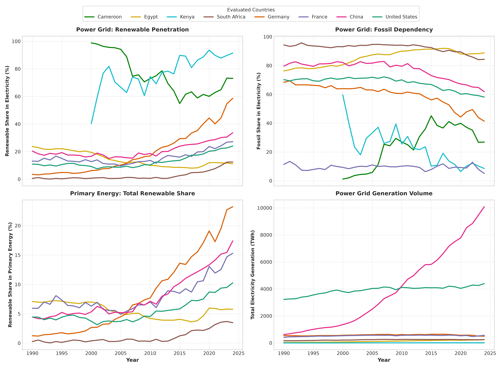
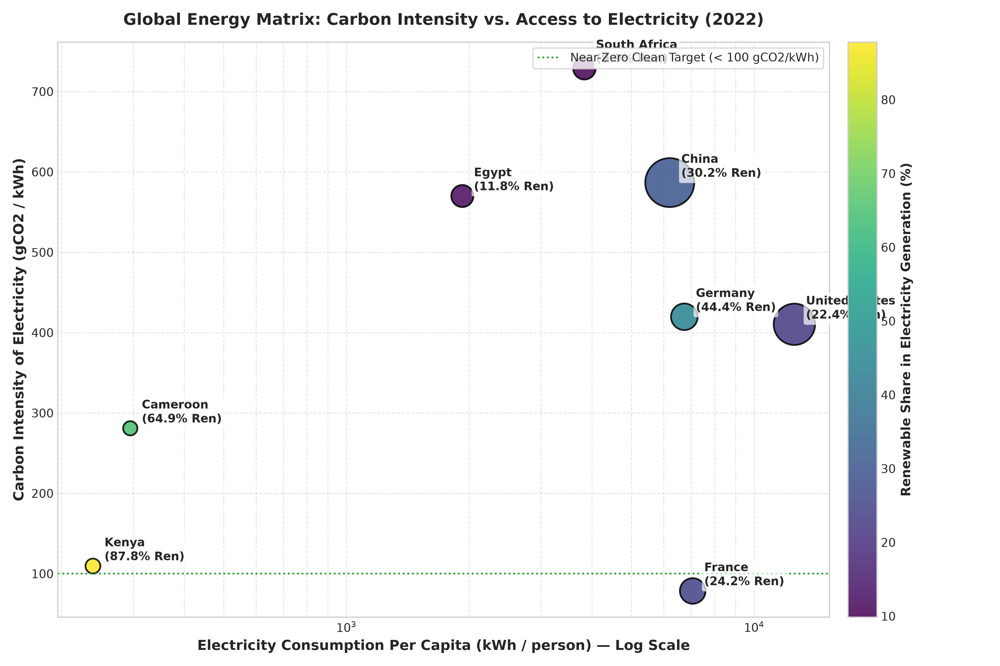
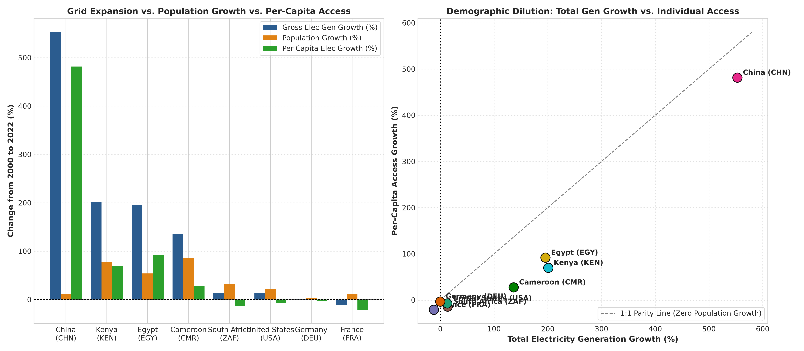
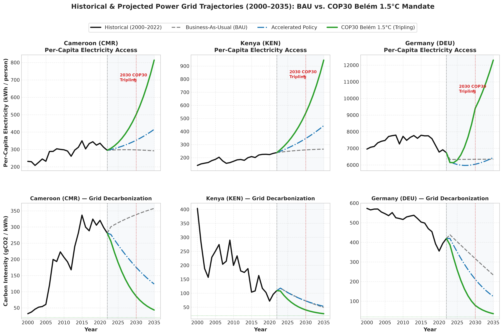

# Global Energy Transition & Decarbonization Analytics

An empirical analysis of macro-energy transition pathways, power sector decarbonization, and electricity access elasticity across global and African economies using the Our World in Data (OWID) World Energy Dataset.

---

## 1. Executive Summary & Core Findings

This project investigates the divergence between macro primary energy consumption and power grid decarbonization from 1990 to 2024 across an expanded 8-country comparative cohort: **Cameroon (`CMR`)**, **Egypt (`EGY`)**, **Kenya (`KEN`)**, **South Africa (`ZAF`)**, **Germany (`DEU`)**, **France (`FRA`)**, **China (`CHN`)**, and the **United States (`USA`)**.

### Key Takeaways:
1. **Primary vs. Power Decarbonization:** High renewable penetration on electricity grids often masks persistent primary fossil dependency (transportation, industrial heat, chemicals), where fossil fuels still account for over 75% of primary consumption in several advanced economies.
2. **The Demographic Dilution Effect:** In emerging economies, gross generation additions do not translate directly into per-capita access. In Cameroon, a **+136.2%** increase in gross power generation between 2000 and 2022 was heavily absorbed by an **+85.3%** population surge, yielding only a **+27.5%** net gain in per-capita electricity.
3. **Transition Regimes & Elasticity ($\varepsilon$):**
   * **Substitution / Decoupling ($\varepsilon < 0$):** Industrialized nations (USA, DEU, FRA) deploy renewables to displace existing thermal/nuclear baseload while per-capita power consumption contracts due to structural efficiency.
   * **Demographically Diluted Expansion ($0 < \varepsilon < 1$):** Sub-Saharan economies (CMR, KEN) expand renewable supply, but rapid demographic growth requires higher capacity factors to achieve per-capita equity.
   * **High Expansion Leverage ($\varepsilon > 1$):** Regimes (EGY) where centralized grid expansion outpaces demographic trends.

---

## 2. Visual Trajectories & Analysis

### Decarbonization & Grid Pathways (1990–2024)


### The Energy Trilemma: Intensity vs. Access (2022 Benchmark)


### Demographic Dilution & Parity Dynamics (2000–2022)


---

## 3. Data Hygiene & Methodological Framework

* **Entity Isolation:** Separated sovereign nations (`iso_code.notna()`) from regional aggregates (e.g., `ASEAN`, `World`, `Africa (EI)`) to prevent double-counting.
* **Structural Zero Imputation:** Missing values for non-existent or emerging technologies (solar, wind, nuclear prior to utility deployment) were imputed as physical zeros (`0.0`) rather than interpolated.
* **Segmented Interior Interpolation:** Linear interpolation was restricted strictly to internal census gaps ($\le 2$ consecutive years) for legacy base fuels (coal, oil, gas, hydro) without boundary extrapolation.
* **Authoritative 2022 Benchmark:** Selected 2022 as the reference year to ensure 100% data completeness across multi-agency census reporting lags for lifecycle carbon intensity (gCO2/kWh) and population metrics.

---

## 4. Benchmark Snapshot (2022)

| Country | ISO | Per-Capita Elec (kWh) | Grid Carbon Intensity (gCO2/kWh) | Renewable Share (%) | Fossil Share (%) |
| :--- | :---: | :---: | :---: | :---: | :---: |
| **France** | `FRA` | 7,068.02 | 78.54 | 24.20 | 12.88 |
| **Kenya** | `KEN` | 238.88 | 109.57 | 87.81 | 12.19 |
| **Cameroon** | `CMR` | 294.94 | 280.98 | 64.91 | 35.09 |
| **United States** | `USA` | 12,551.87 | 410.39 | 22.35 | 59.65 |
| **Germany** | `DEU` | 6,741.65 | 419.74 | 44.37 | 49.50 |
| **Egypt** | `EGY` | 1,924.38 | 570.04 | 11.82 | 88.18 |
| **China** | `CHN` | 6,208.84 | 586.75 | 30.18 | 65.10 |
| **South Africa** | `ZAF` | 3,834.18 | 729.02 | 9.88 | 85.90 |

---

## 5. Elasticity & Structural Transition Regimes (2000–2022)

$$\varepsilon_{\text{access}} = \frac{\% \Delta \text{ Per-Capita Electricity}}{\% \Delta \text{ Renewable Electricity Generation}}$$

| Country | ISO | Renewable Addition (TWh) | Renewable Growth (%) | Per Capita Growth (%) | Elasticity ($\varepsilon$) | Transition Regime |
| :--- | :---: | :---: | :---: | :---: | :---: | :--- |
| **China** | `CHN` | 2,445.10 | 1,084.01 | +481.49 | 0.444 | Demographically Diluted Expansion |
| **Egypt** | `EGY` | 11.35 | 79.59 | +91.82 | 1.154 | High Expansion Leverage |
| **Kenya** | `KEN` | 9.64 | 554.02 | +69.84 | 0.126 | Demographically Diluted Expansion |
| **Cameroon** | `CMR` | 1.88 | 55.13 | +27.49 | 0.499 | Demographically Diluted Expansion |
| **Germany** | `DEU` | 216.13 | 610.36 | -3.08 | -0.005 | Substitution / Decoupling |
| **United States** | `USA` | 607.21 | 173.03 | -7.07 | -0.041 | Substitution / Decoupling |
| **South Africa** | `ZAF` | 22.04 | 1,394.94 | -14.17 | -0.010 | Substitution / Decoupling |
| **France** | `FRA` | 45.54 | 67.14 | -21.06 | -0.314 | Substitution / Decoupling |

---

## 6. Predictive Scenario Modeling: COP30 Belém 1.5°C Mandate (2023–2035)

Integrating the outcomes of the **UNFCCC COP30 Conference (Belém, 2025)**—specifically the **Axis 1 Action Agenda** commitment to triple global renewable capacity by 2030 ($r \approx 14.72\%\text{ CAGR}$), the **Baku-to-Belém Roadmap to 1.3T** in annual climate finance by 2035, and the **Roadmap for Transitioning Away from Fossil Fuels**—this module simulates power grid trajectories from 2023 to 2035 across three scenarios:
1. **Business-As-Usual (`BAU`):** Linear continuation of 2010–2022 generation slopes against exponential demographic growth.
2. **Accelerated Policy:** Moderate compound clean energy expansion ($+8\%/\text{yr}$ for `CMR`/`KEN`; $1.5\times$ historical slope for `DEU`) with gradual thermal phase-down.
3. **COP30 Belém 1.5°C (Tripling):** Full implementation of the $14.72\%/\text{yr}$ renewable tripling mandate and UNEZA grid/storage investments, paired with an orderly fossil phase-down ($-8\%/\text{yr}$ in emerging grids; $-18\%/\text{yr}$ in industrialized grids).



### Projected 2030 & 2035 Grid Milestones

| Country | ISO | Scenario | Renewables 2030 (TWh) | Renewables 2035 (TWh) | Per-Capita 2030 (kWh) | Per-Capita 2035 (kWh) | Carbon Intensity 2030 (gCO2/kWh) | Carbon Intensity 2035 (gCO2/kWh) |
| :--- | :---: | :--- | :---: | :---: | :---: | :---: | :---: | :---: |
| **Cameroon** | `CMR` | `BAU` | 6.11 | 6.62 | 297.36 | 291.84 | 338.16 | 357.48 |
| **Cameroon** | `CMR` | `Accelerated Policy` | 9.79 | 14.39 | 352.67 | 415.29 | 175.39 | 123.52 |
| **Cameroon** | `CMR` | `COP30 Belém 1.5°C` | **15.87** | **31.53** | **500.18** | **813.78** | **86.09** | **43.24** |
| **Kenya** | `KEN` | `BAU` | 15.79 | 18.55 | 259.34 | 265.31 | 72.54 | 49.50 |
| **Kenya** | `KEN` | `Accelerated Policy` | 21.06 | 30.95 | 346.01 | 444.63 | 72.71 | 53.20 |
| **Kenya** | `KEN` | `COP30 Belém 1.5°C` | **34.14** | **67.84** | **539.69** | **945.15** | **40.39** | **26.87** |
| **Germany** | `DEU` | `BAU` | 351.17 | 413.45 | 6,342.90 | 6,349.12 | 316.94 | 233.59 |
| **Germany** | `DEU` | `Accelerated Policy` | 400.99 | 494.40 | 6,044.25 | 6,446.29 | 211.67 | 124.39 |
| **Germany** | `DEU` | `COP30 Belém 1.5°C` | **754.62** | **1,058.39** | **9,405.71** | **12,302.30** | **78.49** | **36.31** |
---

## 7. Project Architecture

```text
owid-energy-transition/
├── data/
│   ├── owid-energy-data.csv                    # Raw dataset (excluded via .gitignore)
│   ├── processed_transition_benchmark_2022.csv # Cross-sectional intensity table
│   └── processed_growth_elasticity_2000_2022.csv
├── figures/
│   ├── global_and_african_power_transition.png # Multi-panel generation trajectory
│   ├── energy_matrix_intensity_vs_access.png   # Bubble chart (gCO2/kWh vs. kWh/person)
│   └── access_growth_dilution_analysis.png     # Parity & demographic dilution plots
├── notebooks/
│   └── 01_global_energy_transition.ipynb       # End-to-end analytical pipeline
├── src/                                        # Modular scripts
├── .gitignore
├── requirements.txt
└── README.md

